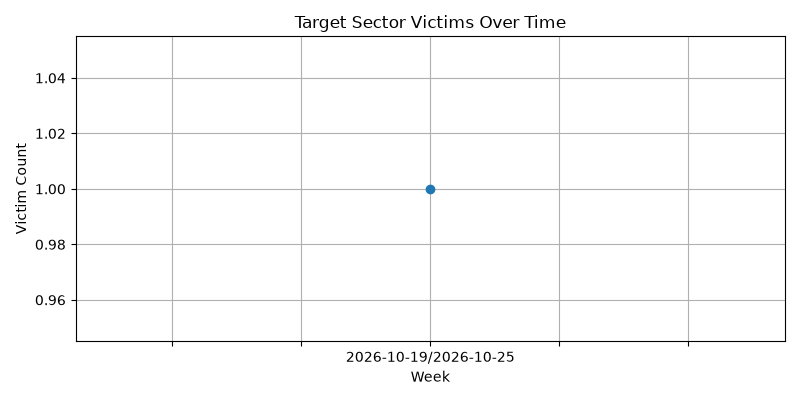
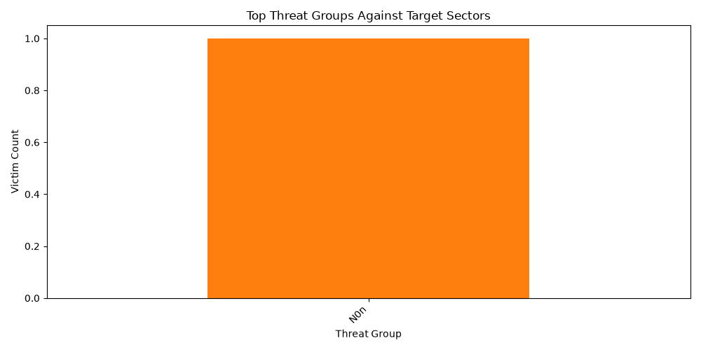

# Ransomware Leak-Site Tracker: Weekly Threat Report
Generated on: 2026-10-25 21:18:02 UTC

## Overview
This report highlights ransomware activity targeting semiconductor, manufacturing, and industrial sectors based on aggregated leak-site data[cite: 12].

- **Total Database Records:** 100
- **Target Sector Victims Identified:** 1

## Top Threat Groups Targeting Target Sectors
- **N0n**: 1 victim(s)

## Visualizations

### Victims Over Time (Weekly Trend)

### Top Threat Groups

